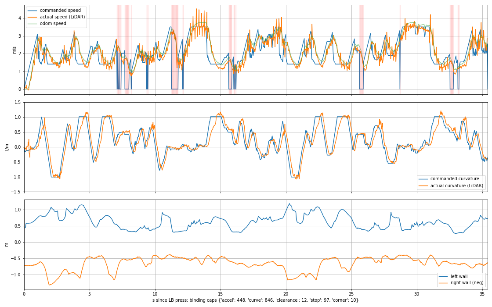

# Run analysis: 20261019-200703

events.jsonl: {'armed': 1, 'first_message': 4, 'status': 7, 'deadman': 2, 'closing': 1}

## LB hold 1: 35.4 s

- held 35.4 s, 1413 drive commands (39.9 Hz)
- odometry distance 78.2 m, mean 2.21 m/s, peak 3.75 m/s
- zero-speed commands: 97 ticks (2.43 s)

### How the car responded

```
speed lag 0.275 s (RMS speed error 0.48 m/s at that lag)
steering lag 0.150 s, curvature gain 0.951 (left 0.955, right 0.942; RMS 0.087 1/m)
achieved lateral accel p50/p90/p99: 1.37 / 2.25 / 3.20 m/s^2
grip (achieved / commanded curvature, by commanded lateral accel):
  0.3-1.0 m/s^2: n= 104 ratio 1.050
  1.0-1.5 m/s^2: n= 215 ratio 1.036
  1.5-2.0 m/s^2: n= 290 ratio 0.991
  2.0-2.5 m/s^2: n= 167 ratio 0.913
  2.5-3.0 m/s^2: n=  70 ratio 0.815
  3.0-5.0 m/s^2: n=  95 ratio 0.737
odom speed scale (LiDAR / odom, by curvature):
  |k| 0.0-0.1 1/m: n= 353 ratio 0.952
  |k| 0.1-0.3 1/m: n= 303 ratio 0.950
  |k| 0.3-0.6 1/m: n= 354 ratio 0.925
  |k| 0.6-2.0 1/m: n= 380 ratio 0.887
```

### Replay through gap_mirror (/home/racerbotcar-2/.claude/jobs/99b7a05b/tmp/yaml_1019.yaml)

- replayed 1413 ticks, 1413 paired with a published /drive
- steering error RMS 0.0012 rad, max 0.0132 rad
- speed error median 0.0000 m/s
- zero-speed ticks: replay 97, real 97; only in replay at [28.746], only in real at [7.334]

binding speed caps: {'accel': 448, 'curve': 846, 'clearance': 12, 'stop': 97, 'corner': 10}

### Stops

- t=  7.10 s, 25 ticks, ttc_brake, odom 2.39 m/s: TTC 0.272 s on a beam at +38 deg, 0.76 m; obstacle 0.33 m from the path (+0.18 m beyond the body edge, gate 0.335 m); body's own path clear for inf m vs stopping distance 0.95 m
- t=  9.37 s, 4 ticks, ttc_brake, odom 1.93 m/s: TTC 0.242 s on a beam at +41 deg, 0.59 m; obstacle 0.33 m from the path (+0.18 m beyond the body edge, gate 0.335 m); body's own path clear for 3.39 m vs stopping distance 0.62 m
- t= 11.26 s, 24 ticks, ttc_brake, odom 3.30 m/s: TTC 0.099 s on a beam at +40 deg, 0.49 m; obstacle 0.33 m from the path (+0.17 m beyond the body edge, gate 0.335 m); body's own path clear for 3.69 m vs stopping distance 1.81 m
- t= 15.64 s, 15 ticks, ttc_brake, odom 1.79 m/s: TTC 0.290 s on a beam at +49 deg, 0.54 m; obstacle 0.30 m from the path (+0.15 m beyond the body edge, gate 0.335 m); body's own path clear for inf m vs stopping distance 0.53 m
- t= 25.63 s, 12 ticks, ttc_brake, odom 2.42 m/s: TTC 0.287 s on a beam at +42 deg, 0.74 m; obstacle 0.33 m from the path (+0.18 m beyond the body edge, gate 0.335 m); body's own path clear for 1.71 m vs stopping distance 0.97 m
- t= 28.71 s, 2 ticks, ttc_brake, odom 2.84 m/s: TTC 0.225 s on a beam at +27 deg, 0.80 m; obstacle 0.33 m from the path (+0.18 m beyond the body edge, gate 0.335 m); body's own path clear for 2.52 m vs stopping distance 1.35 m
- t= 32.54 s, 15 ticks, ttc_brake, odom 1.72 m/s: TTC 0.281 s on a beam at +45 deg, 0.56 m; obstacle 0.27 m from the path (+0.12 m beyond the body edge, gate 0.335 m); body's own path clear for inf m vs stopping distance 0.49 m

### Counterfactual replay with {'ttc_path_margin': 0.05}

- zero-speed ticks: 0 (shipped: 97)
- open-loop: same scans, so where the changed car would have gone is not modelled

- none



